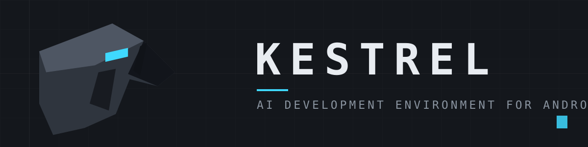

<p align="center">
  
</p>

<p align="center">
  
  
  <a href="LICENSE"></a>
</p>

<p align="center"><b>An autonomous AI coding agent that runs natively on Android.</b><br />
Custom model providers, on-device developer toolchains, and granular agent governance — no root, no PRoot/chroot/QEMU.</p>

## What Kestrel is

Kestrel is a rebuilt, redesigned development environment for Android: it reads, creates, and refactors project source code, executes shell commands, and builds software packages entirely on-device. The engine is reimplemented 1:1 in native Kotlin and driven through a new terminal-inspired interface — a mono-graphite console with a single electric-cyan accent.

| Attribute | Value |
|---|---|
| **Application ID** | `com.kestrel.app` |
| **Launcher** | `com.kestrel.ui.KestrelActivity` |
| **Version** | `1.0.0-beta.1` |
| **Platform** | Android 8.0+ (API 26+) · native `arm64-v8a` · Bionic libc userspace |
| **Design** | Terminal-mono-graphite UI — `#14171C` surfaces, `#3FD9FF` accent |

## Build

Clone this repository, then:

```bash
cd reconstruct
./build.sh        # → dist/Kestrel-1.0.0-beta.1.apk  (kotlinc → d8 → payload → rebrand → sign)
```

Requirements: JDK 21, the Kotlin compiler (2.1.x), Android build-tools (`d8`, `aapt`, `zipalign`, `apksigner`), and Python 3 with Pillow. `build.sh` fetches the API 33 `android.jar`, compiles every DEX from `reconstruct/src`, and rebrands only the staged copies — the `app/` payload stays pristine.

CI compiles and verifies the APK on every push to `main` (`.github/workflows/build-kestrel.yml`): package/label/launcher badging, signing certificate, rebrand assertions on the compiled manifest and resources, and a leaked-API-key scan of the APK contents.

The engine contracts with the core are unchanged from the lineage — ports 48255/48258/48155/48156, the Connect protocol, the `ANTIGRAVITY_*`/`AGY_*` environment, the `etc/hibou/` overlay, and the `agy-*` scripts. Details and port deltas: [`reconstruct/PORTING.md`](reconstruct/PORTING.md).

## Origins & credits

The lineage, stated plainly:

| Stage | What it was |
|---|---|
| **[antigravity-android](https://github.com/werdio325-png/antigravity-android)** ([werdio325-png](https://github.com/werdio325-png)) | Pioneered running Google's Antigravity engine natively in an Android userspace sandbox: the Chromium-to-engine loopback bridge, and the Shizuku (`rish`)/`IntentBridge` execution pipeline. |
| **[Leostryx](https://github.com/Leostrange/Leostryx)** ([Leostrange](https://github.com/Leostrange)) | Custom model providers (OpenAI/Claude/Gemini-compatible) with live catalogs, MCP server integration and tool forwarding, the developer toolchain installer (OpenJDK, Python, Node.js, Flutter), and the Security Shield policy governance. |
| **Hibou** (discontinued) | A predecessor identity of this project, maintained by [@ovrrup](https://github.com/ovrrup): heavily based on the two projects above — an identity rebrand with an English-first interface and bug fixes only; no substantial engine changes. Now retired. |
| **Kestrel** (current) | A complete rebuild: the engine re-authored in native Kotlin, a redesigned terminal-mono-graphite console, and new identity, icons, and build pipeline. Heavily modified by design. |

The engine payload and the 1:1 port remain derivative of antigravity-android and Leostryx and are Apache-2.0 with attribution to their authors. Kestrel's original work — the UI, the binary-resource rebrand tooling, the icon generator, and the build pipeline — is by ovrrup under Apache-2.0. Full lineage and licensing scope: [`NOTICE`](NOTICE).

## Documentation

| Document | Content |
|---|---|
| [`reconstruct/PORTING.md`](reconstruct/PORTING.md) | Porting decisions and the engine contracts kept intact |
| [`docs/BUILD.md`](docs/BUILD.md) | Build pipelines: Kestrel, and the legacy payload tooling |
| [`NOTICE`](NOTICE) | Lineage, attribution, and licensing scope |
| [`CHANGELOG.md`](CHANGELOG.md) | Release history |

## License

[Apache-2.0](LICENSE). Third-party dependencies and components are distributed under their respective licenses.
