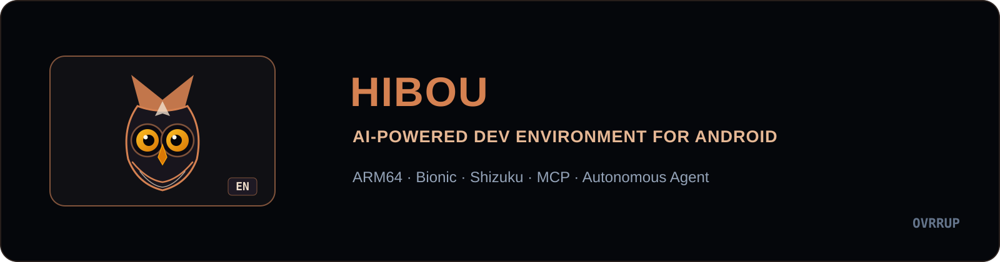
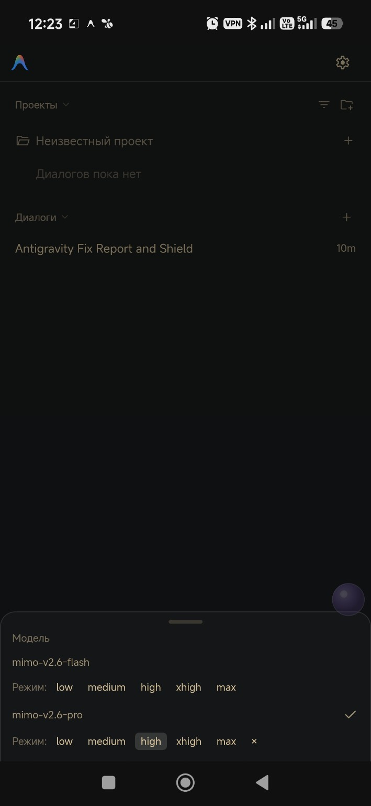
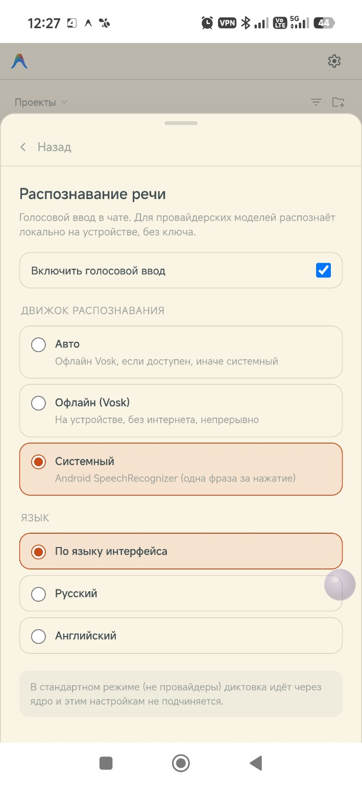

  

  
  
  
  

<b>An AI-powered development environment directly on Android.</b> 
Custom model providers, developer toolchains, and granular agent governance.

  <a href="https://github.com/ovrrup/Hibou/releases/latest"><b>Download APK</b></a> ·
  <a href="docs/USAGE.md">Setup & Usage</a> ·
  <a href="CHANGELOG.md">Changelog</a> ·
  <a href="docs/BUILD.md">Build</a> ·
  <a href="https://github.com/ovrrup/Hibou/issues">Report an Issue</a>

## About the Project

**Hibou** is an autonomous AI coding assistant and development environment designed to run natively on Android devices. It equips developers with an intelligent coding agent that reads, creates, and refactors project source code, executes shell commands, and builds software packages on-device without requiring a PC, root permissions, or heavy virtualization containers (PRoot/chroot/QEMU).

As the first unified model of the app, Hibou versioning begins with **`1.0.0-beta.1`**.

### Project Lineage

| Stage | What it was |
|---|---|
| **Antigravity on Android** ([werdio325-png](https://github.com/werdio325-png)) | Pioneered running Google's Antigravity engine natively in an Android userspace sandbox. |
| **[Leostryx](https://github.com/Leostrange/Leostryx)** ([Leostrange](https://github.com/Leostrange)) | Custom providers, MCP integration, developer toolchain and security governance on that foundation. |
| **Hibou** (earlier releases of this repository) | Maintained by [@ovrrup](https://github.com/ovrrup): heavily based on the projects above — a rebrand with an English-first interface and bug fixes only; no substantial engine changes. |
| **Kestrel** (current) | A complete rebuild: the engine reimplemented 1:1 in native Kotlin, a redesigned terminal-mono-graphite console UI, new identity and icons, and its own build pipeline. Heavily modified by design. |

## Kestrel — the rebuild

Kestrel is produced by this repository as the successor to Hibou. Everything the shipped DEX did is reimplemented in native Kotlin (`reconstruct/src/`), the UI is a new terminal-inspired mono-graphite console (`reconstruct/src/com/kestrel/`), and the app ships as **`com.kestrel.app`** (launcher `com.kestrel.ui.KestrelActivity`) with its own icon set and signing key.

- **Build:** `reconstruct/build.sh` (kotlinc → d8 → payload → rebrand → sign); CI compiles and verifies it on every push to `main`.
- **Integrity:** engine contracts with the core are unchanged — ports 48255/48258/48155/48156, the Connect protocol, `ANTIGRAVITY_*`/`AGY_*` environment, the `etc/hibou/` overlay, `agy-*` scripts — see [`reconstruct/PORTING.md`](reconstruct/PORTING.md).
- **Licensing:** see [`NOTICE`](NOTICE) for the full lineage and scope.

| Attribute | Specification |
|---|---|
| **Application ID** | `agy.hibou` |
| **Initial Release** | `1.0.0-beta.1` (versionCode 1) |
| **Platform & Architecture** | Android 8.0+ (API 26+) · Native `arm64-v8a` (ARM64) |
| **Runtime Environment** | Native Android Userspace / Bionic libc (no PRoot/chroot overhead) |
| **Default Language** | English (`en`) with full Russian (`ru`) support |

---

## Credits & Acknowledgements

Hibou is built upon the foundational contributions of two developers whose ingenuity and open-source projects made this application possible. We express our deepest gratitude to:

### 1. [werdio325-png](https://github.com/werdio325-png) — [`werdio325-png/antigravity-android`](https://github.com/werdio325-png/antigravity-android)
* **What they made possible:**
  - **Native Android Architecture:** Pioneered running Google Antigravity directly in an Android userspace sandbox (`ARM64` / Bionic libc).
  - **Chromium-to-Engine Bridge:** Engineered the loopback HTTPS connection between the Chromium WebView UI and the local Go/C++ `language_server` core.
  - **Privilege & System Integration:** Created the native `IntentBridge` and Shizuku (`rish`) execution pipeline, granting terminal tools process management capabilities without root.

### 2. [Leostrange](https://github.com/Leostrange) — [`Leostrange/Leostryx`](https://github.com/Leostrange/Leostryx)
* **What they made possible:**
  - **Custom AI Model Providers:** Designed the third-party provider interface supporting OpenAI-compatible, Anthropic Claude, and Gemini API endpoints with real-time model catalog queries and model selector grouping.
  - **Model Context Protocol (MCP):** Enabled MCP server integration and dynamic tool forwarding directly to custom AI models.
  - **Developer Toolchain & Security:** Built the in-app package manager and tool installer (OpenJDK, Python, Node.js, Flutter), the in-app diagnostics console, error history tracking, and the Security Shield policy governance.

Hibou is developed, maintained, and curated by [@ovrrup](https://github.com/ovrrup), unifying these foundations with an English-first interface, streamlined updates, and owl visual branding. To be precise about what changed: Hibou was an identity rebrand and bug-fix line over these projects — the engine itself remained upstream's work. The [Kestrel](#kestrel--the-rebuild) rebuild is where the code was re-authored in full.

---

## Features

| Category | Available Features |
|---|---|
| **Chat & Models** | Standard and custom providers (OpenAI, Claude, Gemini-compatible), model grouping, reasoning/thinking modes, up to 10 file attachments |
| **Agent Governance** | Security Shield: file and network access rules, terminal command auto-execution policies, browser JavaScript execution permissions |
| **Developer Tooling** | In-app component installer, Android SDK/NDK, OpenJDK, Node.js LTS, Python 3, and Flutter/Dart toolchains |
| **Integrations** | Model Context Protocol (MCP) servers, UTCP/OpenAPI, agent skills, system rules, and UI plugins |
| **Diagnostics & Data** | In-app console and error history in Tools settings, logcat extraction, session export (text, images, PDF), and comprehensive backup/restore |
| **UI & Customization** | English default with instant Russian switching, light and dark themes, and four branding packs: Owl (Hibou mascot), Lynx, LSX, and Angular X |

## Screenshots

<table>
  <tr>
    <td align="center"> Home Screen</td>
    <td align="center"> Model Selector</td>
    <td align="center"> Security Shield</td>
  </tr>
</table>

Themes and Dictation

<table>
  <tr>
    <td align="center"> Light Theme</td>
    <td align="center"> Dark Theme</td>
    <td align="center"> Voice Dictation</td>
  </tr>
</table>

## Download & Install · v1.0.0-beta.1

| Variant · 1.0.0-beta.1 | Description | Download |
|---|---|---|
| **Standard** | Clean baseline build without core regional check patches | [Standard APK](https://github.com/ovrrup/Hibou/releases/download/v1.0.0-beta.1/Hibou-1.0.0-beta.1-standard.apk) |
| **Bypass** | Patched build bypassing core engine regional restrictions | [Bypass APK](https://github.com/ovrrup/Hibou/releases/download/v1.0.0-beta.1/Hibou-1.0.0-beta.1-bypass.apk) |

1. Download your preferred APK from [Releases](https://github.com/ovrrup/Hibou/releases/latest).
2. Allow installation from unknown sources in Android settings and install the APK.
3. On first run, complete initial permissions and language setup, then sign in or connect your preferred model provider.

## Important Considerations

- Standard and custom providers operate under different core modes; refer to the [Setup Guide](docs/USAGE.md) for configuration instructions.
- Voice dictation with custom providers leverages Android's on-device SpeechRecognizer.
- Model, regional, and external API availability depends on the provider. The Bypass variant modifies core regional checks but does not guarantee third-party API accessibility.
- The tools catalog lists available development packages; packages are downloaded and installed on demand via settings.

## Documentation

| Document | Content |
|---|---|
| [Setup & Diagnostics](docs/USAGE.md) | Installation, providers, toolchain, MCP, error logging, and backup management |
| [Building Hibou](docs/BUILD.md) | APK modification workflow, dependencies, and reproducibility notes |
| [Changelog](CHANGELOG.md) | Release history starting from 1.0.0-beta.1 and development lineage |
| [Development Archive](docs/CHANGELOG-ARCHIVE.md) | Technical archive of preceding experimental builds |
| [Flutter/Dart](docs/flutter-toolchain.md) · [JVM & jadx](docs/jadx-fixes.md) | Specialized setup and troubleshooting guides |

## License

Licensed under [Apache 2.0](LICENSE). Third-party dependencies and components are distributed under their respective licenses.
