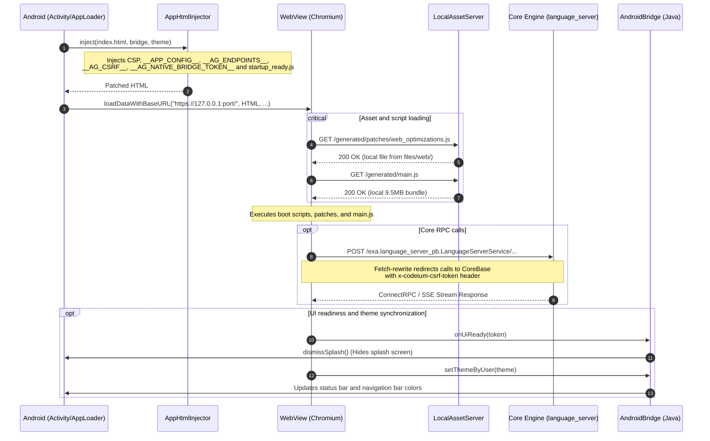

# Antigravity Web Interface: `web/`

> Single Page Application (React-based SPA) running inside an isolated Android WebView and communicating with the local Go/C++ core (`language_server`) via loopback HTTPS and a native Java bridge (`AndroidBridge`).

---

## 1. Architectural Overview

The Antigravity web layer is a specialized UI frontend bundled into the application assets and optimized for touch interactions on Android ARM64. Instead of loading via the legacy `file:///android_asset/` scheme (which blocks modern browser features and ConnectRPC), the interface is mounted in the `WebView` using `loadDataWithBaseURL` targeting a trusted loopback origin `https://127.0.0.1:<port>/`.

### Architecture Sequence Diagram



---

## 2. Directory Structure

```
web/
├── build.sh                      # Bash orchestrator for bundling and patching
├── src.manifest                  # Declarative manifest for web/generated/**
├── patch_main.py                 # Patcher for upstream main.js (Desktop Mode + monochrome Eza)
├── index.html                    # Root HTML template for the app host
├── main.js                       # Upstream obfuscated React UI bundle (~9.9 MB)
├── jetbox.css                    # Control and terminal styles
├── compiled_tailwind.css         # Base compiled Tailwind CSS bundle
├── prism_bundle.js               # PrismJS syntax highlighting bundle (deferred)
├── diff_worker.js                # Web Worker for background string diff computation
├── audio_processor.js            # AudioWorkletProcessor for 16 kHz streaming audio
├── antigravity-icon.png          # Application launcher icon
├── google_signin.svg             # Sign-in button vector asset
├── symbols-icons/                # Local cache for Material Symbols
├── workers/                      # PDF.js integration modules
│   ├── pdf.min.mjs               # PDF.js core library
│   ├── pdf.worker.mjs            # PDF parsing worker
│   └── pdfjs_loader.mjs          # Bridge between Closure compiler and ESM PDF.js
├── generated/                    # Build artifact directory (generated by build.sh)
│   ├── main.js                   # Patched production application bundle
│   ├── bridge.core.js            # Bridge core, polyfills, and fetch rewriter
│   ├── boot/                     # Early initialization scripts (<head>)
│   │   ├── custom-elements-guard.js
│   │   └── theme-bootstrap.js
│   └── patches/                  # Mobile patches and adapters
│       ├── web_optimizations.js
│       ├── touch_model_menu.js
│       ├── theme_sync.js
│       └── startup_ready.js
├── src/                          # Modular fragment sources
│   ├── boot/                     # Early bootstrap fragments
│   ├── core/                     # Bridge core fragments (namespace, csrf, fetch, ...)
│   └── patches/                  # Functional patch fragments
└── tests/
    └── selftest.sh               # Build verification and integrity test
```

---

## 3. Bundling Pipeline

The web layer is built using [`build.sh`](build.sh) driven by [`src.manifest`](src.manifest). The pipeline ensures the upstream `main.js` remains unmodified, writing all changes exclusively to `web/generated/main.js`.

### Manifest Syntax (`src.manifest`)
- `bundle iife <path>` — declares a bundle wrapped in an isolated IIFE `(function(){ ... })();`. If the source fragments already contain a top-level closure, `build.sh` automatically avoids redundant wrapping.
- `bundle <path>` — concatenates fragments without closure wrapping.
- `src/<path>` — appends a source fragment to the active bundle.
- Lines starting with `#` and `;` are comments.

### Generated Bundles

| Bundle (`web/generated/...`) | Mode | Size | Description |
|---|---|---|---|
| **`boot/custom-elements-guard.js`** | IIFE | ~514 B | Prevents duplicate registration crashes with Custom Elements in overlay bundles. |
| **`boot/theme-bootstrap.js`** | IIFE | ~1.3 KB | Immediately sets `light`/`dark` before initial render, preventing white flashes. |
| **`bridge.core.js`** | IIFE | ~12 KB | Polyfills `window.process`, configuration, CSRF, endpoint discovery, and `fetch` interceptor. |
| **`patches/web_optimizations.js`** | IIFE | ~2.2 KB | Eliminates 300ms tap delay, stabilizes `--agy-vvh` viewport height during IME display, forces GPU compositing. |
| **`patches/touch_model_menu.js`** | IIFE | ~6.7 KB | Adapts Base UI mouse-hover model submenus for mobile touch interaction. |
| **`patches/theme_sync.js`** | IIFE | ~4.7 KB | MutationObserver monitoring `<html>`/`<body>` classes to sync theme state with native Android. |
| **`patches/startup_ready.js`** | IIFE | ~4.7 KB | Detects initial DOM render and captures uncaught errors for `AndroidBridge`. |
| **`main.js`** | Raw + Patch | ~9.5 MB | Production React UI bundle patched via `patch_main.py`. |

---

## 4. Upstream Bundle Patching (`patch_main.py`)

[`patch_main.py`](patch_main.py) performs modifications on the compiled `main.js`:
1. **Idempotence**: Checks for existing `"Desktop Mode"` or `"ag_desktop_mode"` markers before applying changes.
2. **Desktop Mode Toggle**: Injects React hooks into the Appearance settings component, connecting state with `window.Android.isDesktopMode()` and `localStorage`.
3. **Monochrome Eza Logo**: Replaces multi-colored hardcoded SVG elements with flat monochrome vectors respecting light/dark theme CSS tokens.

---

## 5. Native Android Bridge (`AndroidBridge`)

The web application runs inside a Chromium-based WebView where `Android` (and alias `window.AndroidBridge`) is exposed via `addJavascriptInterface`.

### Boot Injections (`AppHtmlInjector`)
Before feeding HTML to WebView, `AppHtmlInjector` injects into `<head>`:
- **Strict Content Security Policy (CSP)**: restricts frame sources, allows `worker-src 'self' blob:`.
- **Global Configuration Parameters**:
  - `window.__APP_CONFIG__` — environment parameters (version, paths).
  - `window.__AG_ENDPOINTS__` — core server endpoints.
  - `window.__AG_CSRF__` — cryptographic CSRF token for core authentication.
  - `window.__AG_HOST_THEME__` / `window.__AG_RESOLVED_THEME__` — host theme state.
  - `window.__AG_NATIVE_BRIDGE_TOKEN__` — 32-byte one-time token for privileged native actions.
- **Ready Signal Script**: `<script src="./generated/patches/startup_ready.js"></script>`.

### Bridge Methods (`window.Android`)

| Method | Signature | Description |
|---|---|---|
| `onUiReady` | `(token: string) => void` | Invoked on initial DOM paint to dismiss the Android splash screen. |
| `onUiError` | `(token: string, message: string) => void` | Reports fatal JavaScript runtime errors to logcat. |
| `setThemeByUser`| `(theme: string) => boolean` | Notifies Android of user-selected theme to update status bar coloring. |
| `onVisualThemeChanged` | `(theme: string) => void` | Signals changes in active CSS styling. |
| `getTheme` | `() => string` | Returns current device system theme. |
| `isDesktopMode` | `() => boolean` | Checks whether desktop viewport mode is enabled. |
| `setDesktopMode`| `(enabled: boolean) => void` | Switches WebView User-Agent and viewport configuration. |
| `openDirectoryPicker` | `() => void` | Launches SAF directory picker to open project workspaces. |
| `saveBlob` | `(token, base64, filename, mime) => void` | Saves generated blobs to the device `Downloads` directory. |

---

## 6. Web Subsystems

### 6.1. Mobile & Touch Optimizations
- **`web_optimizations.js`**:
  - `touch-action: manipulation` removes the 300ms double-tap delay on interactive controls.
  - `visualViewport.addEventListener('resize')` dynamically recomputes `--agy-vvh` in pixels, avoiding input box jumping when the on-screen keyboard appears.
  - Selective `transform: translateZ(0)` promotes key scroll containers (`chat-container`, `.scrollable`) to GPU layers.

### 6.2. Core Transport & Fetch Rewrite
- **`bridge.core.js`**:
  - Polyfills `window.process` for ARM64 Linux userspace.
  - Rewrites `window.fetch` requests directed at ConnectRPC endpoints to target the local engine origin `https://127.0.0.1:<enginePort>`.
  - Injects `x-codeium-csrf-token` headers and `csrf_token` query parameters.
  - Provides retry logic with exponential backoff (`fetchWithStartupRetry`) to handle early frontend requests before the core TLS server is fully bound.

### 6.3. Settings Overlay Scripts
- **`agy_tools.sh`**: Backend for Settings → Tools (invoked via `AgyTools` native bridge). Manages package installation, verification, and updates with built-in download retries.
- **`agy_providers.js`**: Manages custom model providers (OpenAI, Claude, and Gemini API formats) with model discovery and capability overrides.
- **`agy_shield.js`**: Manages agent security policies and global permission grants.
